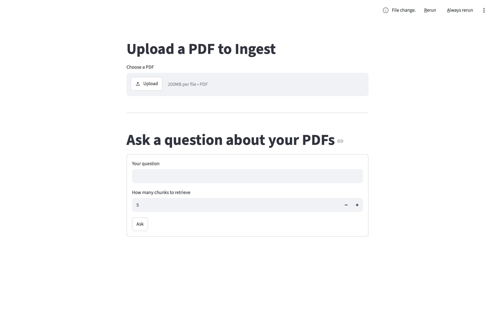
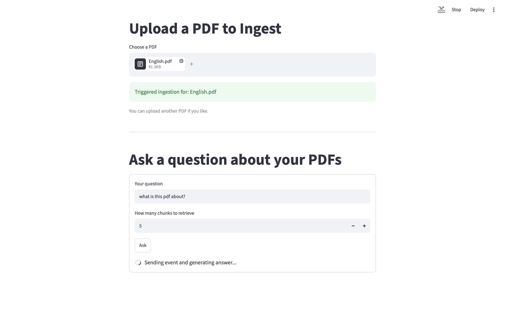
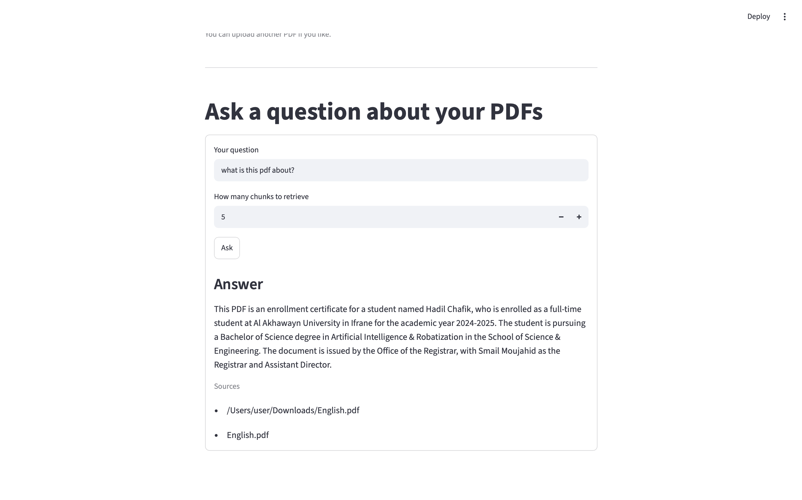

# 📚 RAG PDF Assistant
## 📸 Application Preview

### Home Screen



### Uploading a PDF



### Asking Questions




A Retrieval-Augmented Generation (RAG) application that lets users upload PDF documents and ask natural language questions about their contents. The project uses Inngest to orchestrate asynchronous PDF ingestion, allowing document processing to run as an event-driven workflow.

Instead of relying only on an LLM's built-in knowledge, the application retrieves relevant document chunks using semantic search before generating an answer.

---

## ✨ Features

- 📄 Upload PDF documents
- ✂️ Automatic document chunking
- 🧠 OpenAI embeddings (`text-embedding-3-large`)
- 🗄️ Qdrant vector database
- 🔍 Semantic similarity search
- 🤖 GPT-4o answer generation
- ⚡ Event-driven ingestion with Inngest
- 🌐 Streamlit interface

---

## 🏗 Architecture

           PDF Upload
                │
                ▼
          FastAPI API
                │
                ▼
        Inngest Event Trigger
                │
                ▼
        PDF Processing Worker
                │
                ▼
      LlamaIndex PDF Reader
                │
                ▼
       Sentence Splitter
                │
                ▼
     OpenAI Embeddings
                │
                ▼
   Qdrant Vector Database
                │
                ▼
      Semantic Retrieval
                │
                ▼
            GPT-4o
                │
                ▼
         Generated Answer
---

## ⚙️ Tech Stack

| Technology | Purpose |
|------------|----------|
| Python | Backend |
| FastAPI | API |
| Streamlit | Frontend |
| OpenAI | Embeddings + LLM |
| Qdrant | Vector Database |
| Docker | Runs Qdrant |
| Inngest | Event Workflow |
| LlamaIndex | PDF Processing |
| Inngest |Event-driven workflow orchestration |
---

## 🚀 How It Works

1. Upload a PDF.
2. Extract text using LlamaIndex.
3. Split text into overlapping chunks.
4. Generate embeddings with OpenAI.
5. Store vectors in Qdrant.
6. Embed the user's question.
7. Retrieve the most relevant chunks.
8. Send context + question to GPT-4o.
9. Return an answer grounded in the uploaded document.

---

## 📦 Installation

```bash
git clone https://github.com/hadilch2004/rag-pdf-assistant.git
cd rag-pdf-assistant

uv sync

uvicorn main:app --reload

streamlit run streamlit_app.py
```

---

## 🔑 Environment Variables

Create a `.env` file.

```text
OPENAI_API_KEY=your_api_key_here
```

---

## 📚 Concepts Demonstrated

- Retrieval-Augmented Generation (RAG)
- Embeddings
- Vector Databases
- Semantic Search
- Cosine Similarity
- Transformer Models
- Prompt Engineering
- FastAPI
- Event-Driven Workflows
- Docker

---

## 🚀 Future Improvements

- Multiple PDF support
- Chat history
- Conversation memory
- Source highlighting
- User authentication
- Cloud deployment

---

## 📄 License

Educational project.


